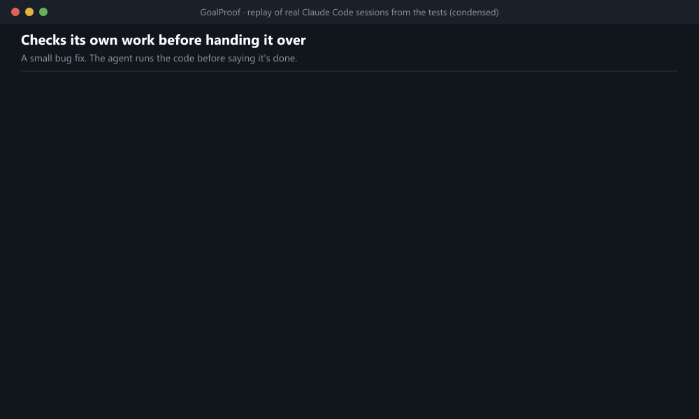
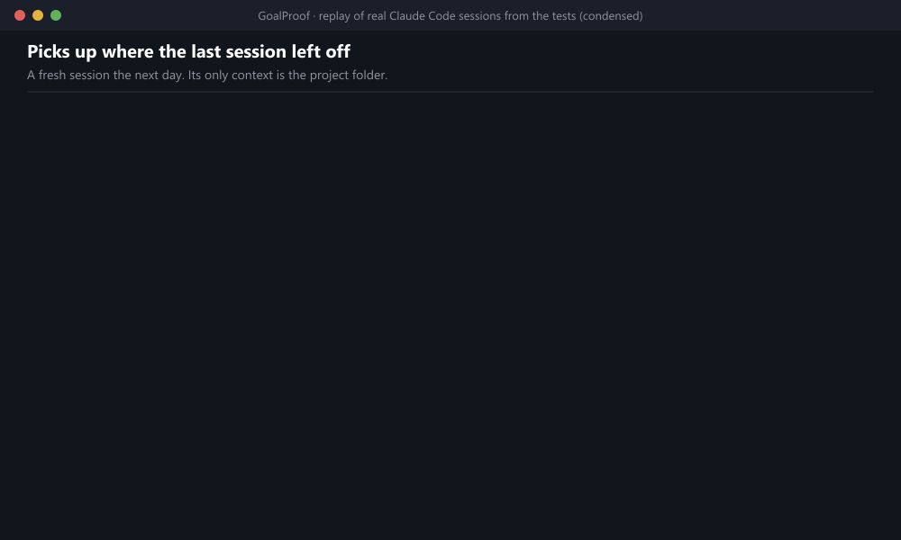
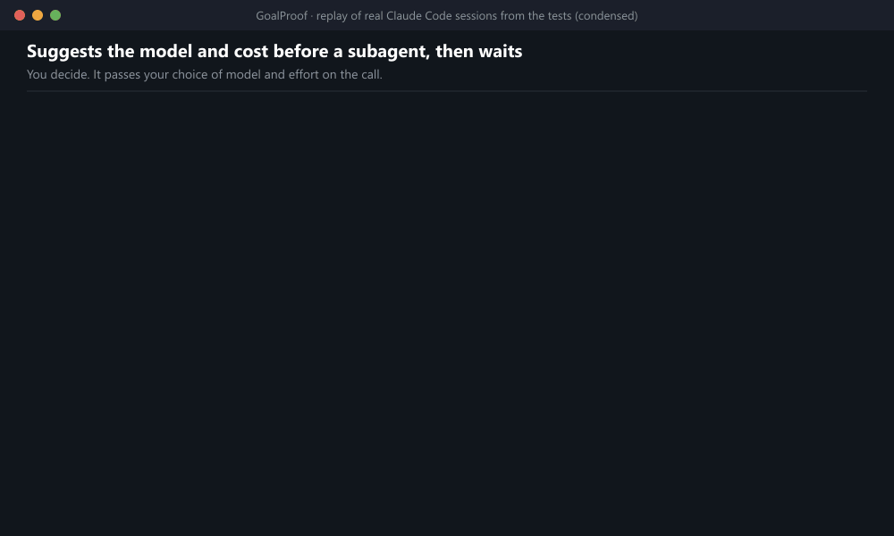
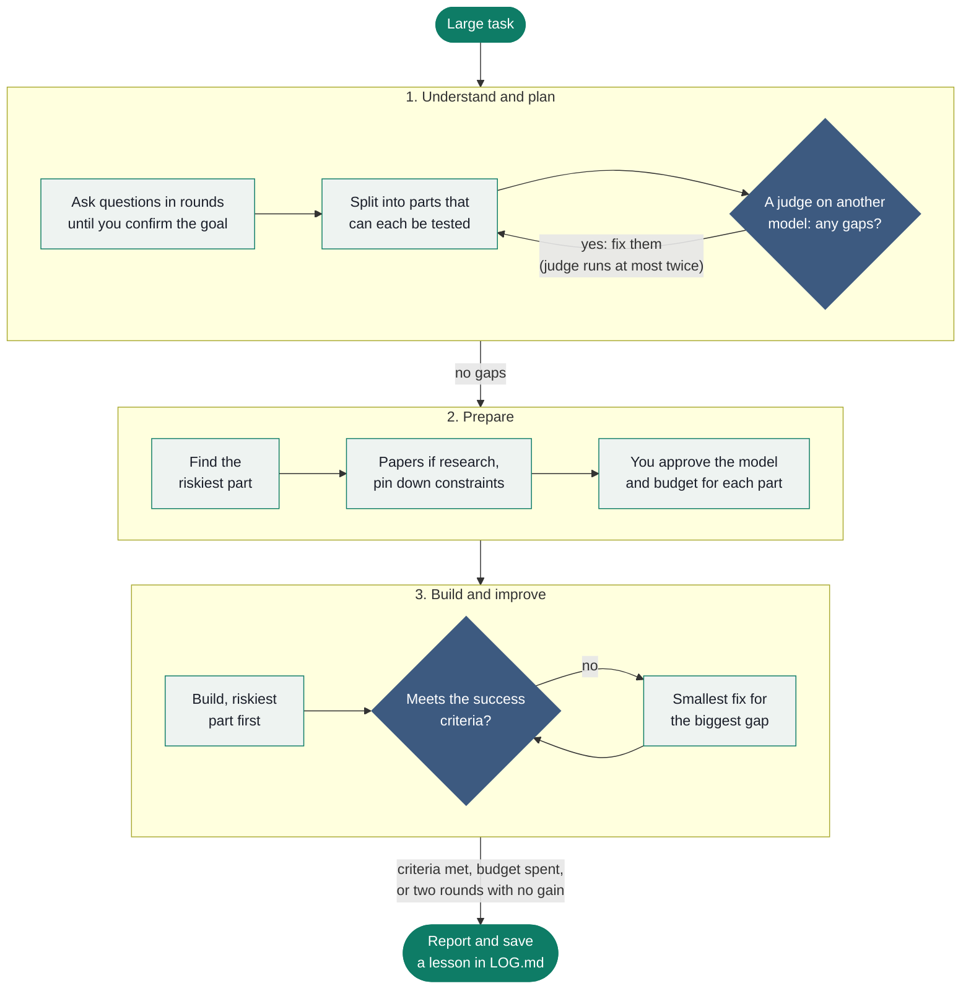

# GoalProof

GoalProof is an open-source, domain-flexible operating layer for AI agents that guides them from a goal to a verified outcome through structured planning, clarification, independent review, and measurable acceptance criteria. It adapts workflow complexity to the task, coordinates subagents through shared plans, and preserves decisions and lessons across sessions. Its key contribution is making agent execution evidence-driven: success is established through verification and measurable results, not the agent's confidence.

Works with Claude Code, Codex, Cursor, GitHub Copilot, Gemini CLI, and other agents that read [`AGENTS.md`](https://agents.md/), the open instruction-file format used by over 20 coding agents.

> Unofficial community project, not affiliated with, sponsored by, or endorsed by Anthropic or any other AI provider. Claude and Claude Code are trademarks of Anthropic, PBC; other product names belong to their owners and are used only to say what this project works with.

**Measured:** in a 160-run A/B test with Claude Code, first-attempt accuracy on unclear tasks rose from 52% to 92%, and subagent reviews used 87% fewer tokens, for about 10% more agent spend per task. [See the results](#results), including where it did worse.

**See it in action.** Each clip is a condensed replay of a real session from the tests.

**1. It checks its own work before handing it over.**



**2. It picks up where the last session left off.**



**3. It suggests the model and cost before calling a subagent, then waits for you.**



*In these replays the agent's words are as written; file paths are shortened, repeated file reads are merged, two retried commands are left out, and long replies are cut short.*


## Quick start

**1. Install** (about a minute)

*Claude Code*, for all your projects (macOS / Linux; Windows commands are under [Install](#claude-code-all-projects)):

```bash
git clone https://github.com/asif07hossain/goalproof.git && cd goalproof
mkdir -p ~/.claude/skills ~/.claude/agents
cp AGENTS.md models.md adapters/claude-code/CLAUDE.md ~/.claude/
cp -r skills/* ~/.claude/skills/ && cp adapters/claude-code/agents/*.md ~/.claude/agents/
```

Already have a `~/.claude/CLAUDE.md`? Back it up first, then merge the two by hand. Recommended: also add the safety rules and the reminder hook from `adapters/claude-code/settings.example.json` to `~/.claude/settings.json` (see [Install](#claude-code-all-projects)).

*Any other agent* (Codex, Cursor, GitHub Copilot, Gemini CLI, and others), per project:

```bash
git clone https://github.com/asif07hossain/goalproof.git
cp goalproof/AGENTS.md goalproof/models.md your-project/ && cp -r goalproof/skills your-project/
```

Optional: fill in the Environment section of `AGENTS.md`, so the agent knows your OS and installed tools.

**2. Check it's on.** Start a new session and ask: *"What workflow size would you use to fix a typo?"* The answer should start with a line like `Workflow: small · current settings are fine`.

**3. Give it real work.** Use your own task, or try one of these to see the three main behaviours:

| You type | What the agent does with GoalProof |
|---|---|
| *Fix the bug where `paginate()` skips the last page.* | Starts with the Workflow line, shows the bug first, fixes it, runs the tests, and reports what it checked. |
| *Add CSV export to the reports page.* | Asks about what isn't clear (columns, filters, file name) before building, or builds the broader reading and lists its assumptions. |
| *I want to build a reading-list app with user accounts.* | Asks questions over several rounds until you confirm the goal, asks which GoalProof stages you want, suggests a model and effort for each part, then writes `PLAN.md` and runs the stages you picked, such as a design review by a reviewer you choose. |

In Claude Code, you can also start the full workflow directly with `/playbook`.

**4. Stay in charge.** Every suggestion is yours to accept or change: *"use the large workflow"*, *"skip the during-execution checks"*, *"use Opus for the parser"*, *"lower the effort"*. To remove GoalProof, delete the files you copied.

## What sets it apart

Coding agents keep getting better at writing code and running tests. What they still struggle with is judgment around the code: whether a design is appropriate, staying aligned with the original goal, spotting architectural bottlenecks early, knowing when to reconsider a plan, and avoiding unnecessary complexity. GoalProof is a lightweight decision and workflow control layer for exactly that: **are we doing the right work, in the right way?** Whether the code works is a question for your tests; GoalProof uses their results as evidence.

It guides and challenges the agent at three stages, without micromanaging each action:

| Stage | The question | What happens |
|---|---|---|
| **Before execution** | Is this the right design and plan? | `PLAN.md` sets out the goal in your words, measurable success criteria, the scope, the parts, and the milestones. The design is challenged for parts, dependencies, or abstractions the goal doesn't need. Each decision that is costly to undo comes with an alternative for you to choose, and the riskiest bottleneck is built first. A reviewer you choose can check the plan before anything is built. |
| **During execution** | Are we still on track? | After each part, a short check against the plan. If the work drifts from the goal, or the evidence says the plan is wrong, the agent stops and you choose: continue, adjust the plan, or revert. |
| **After execution** | Did we achieve what was intended? | Each success criterion is marked met, not met, or unverified, with its evidence, and an independent outcome review is offered with its cost. |

**You choose the stages, per task.** Each stage costs time and tokens up front to save rework later, so at the start of a medium or large task the agent asks which ones you want and recommends those that fit. In Claude Code, the question opens as a selection window:

```
Which GoalProof stages for this task? (choose any)
[x] Before execution: validate the design and plan       (Recommended)
[ ] During execution: monitor progress and deviations
[x] After execution: review the outcome                  (Recommended)
```

Each option shows its benefit and rough cost. Your choice is saved in `PLAN.md`, so later sessions follow it, and you can change it anytime. To skip the question, set a default once in the Boundaries line of `AGENTS.md`, for example "supervision: before and after execution". Small tasks don't ask: they are done, then checked against your request. GoalProof also suggests the workflow size, model, effort, and subagents; you make the call.

![Typical agent setup next to GoalProof, step by step. Typical: prompt; no agreed definition of done; no plan review; agent writes code; agent says it is done; you find the bugs and it tries again; the next session starts from scratch. With GoalProof: goal clarified until you confirm it; plan with success criteria, decisions, and dependencies; plan reviewed by a separate reviewer; build part by part on the model you picked; a milestone check after each part, and if the work has drifted, adjust; outcome reviewed against the goal; lesson and plan saved for the next session.](docs/compare.png)

| | Typical agent setup | GoalProof |
|---|---|---|
| **When is it done?** | When the agent says so | When the success criteria agreed at the start are met, with evidence |
| **Who checks the plan?** | Usually no one, or the model that wrote it | A separate reviewer, at most twice, reading a plan file to save tokens; a different model is suggested, not imposed |
| **How much process?** | The same for every task | Scaled to the task: a one-line fix is just run and checked; a new project gets the full workflow |
| **Which model does the work?** | One model for everything | You pick per part, from cheap to strongest, so spending follows difficulty |
| **Who decides?** | The agent, silently | GoalProof suggests the workflow size, model, effort, and subagents; you choose |
| **AI experiments** | "It improved" after one run | Baseline first, held-out data, repeated runs, and a noise estimate before any claim |
| **Mistakes** | Repeated in the next session | A correction made twice becomes a rule; lessons carry over in `LOG.md` |
| **Which agents?** | Tied to one tool | One `AGENTS.md` for any agent that reads it, plus thin adapters |

## Results

These results were measured with an earlier version of the rules; the current version, built around the three supervision stages, has not been re-measured yet. Every experiment runs the same agent (Claude Code on Sonnet, medium effort) on the same tasks, 5 times with GoalProof switched on and 5 times with it off. Hidden checks that the agent never sees decide whether its code is right, and when the agent asks a question, a simulated user answers it. That makes 160 runs in all, about \$34 at API list prices.

**Evidence** comes from 95% bootstrap confidence intervals. *Strong* and *Moderate* mean the result holds across tasks; *Supported* means it holds on one task; *Weak* means better on average, but it could be chance; *Against* means GoalProof was reliably worse.

### 1. Unclear coding tasks

We gave the agent small coding tasks with unclear requirements or tricky bugs. The "unseen" tasks, a CSV line parser and a vague bug report about duplicate emails, were written after the rules were tuned.

| Metric | Without | With GoalProof | Change [95% CI] | Evidence |
|---|---|---|---|---|
| First try passes the hidden checks (unseen tasks) | 52% | **92%** | +40 pts [+20, +50] | Moderate |
| Extra messages needed from you (unseen tasks) | 0.9 | **0.5** | −0.4 [−0.5, −0.2] | Moderate |
| Ran its own code before handing it over (unseen tasks) | 0% | **100%** | +100 pts [+100, +100] | Strong |
| Extra messages needed from you (tasks used for tuning) | 0.4 | **0.2** | −0.2 [−0.3, −0.2] | Moderate |
| Solved in the end | 100% | 100% | none | No difference |
| Agent spend per task (unseen tasks) | \$0.143 | \$0.155 | +\$0.012 (+9%) [+\$0.001, +\$0.029] | Against |
| Agent spend per task (tasks used for tuning) | \$0.121 | \$0.134 | +\$0.013 (+11%) [+\$0.001, +\$0.022] | Against |
| Agent spend on a trivial bug fix | \$0.060 | \$0.078 | +\$0.018 (+29%) [+\$0.017, +\$0.018] | Against |
| Agent time per task (unseen tasks) | 9 s | 15 s | +7 s [+6 s, +8 s] | Against |

**Example, first row.** The prompt was *"Add `parseCsvLine(line)` to src/csv.js."* Without GoalProof, the agent wrote correct parsing logic, but in 4 of 5 runs it exported the function with `module.exports` in a project set up for ES modules. It handed the code over without running it, so the code failed to load and you had to report the error. With GoalProof, the agent ran its code before handing it over, and its first version passed all 7 hidden checks in 5 of 5 runs.

### 2. Continuing in a new session

The first session added `parseDuration` and was told the next step would be `formatDuration`. A second, fresh session got only *"Continue the duration work from last session."*

| Metric | Without | With GoalProof | Change [95% CI] | Evidence |
|---|---|---|---|---|
| Extra messages needed from you | 1.0 | **0** | −1.0 [−1.0, −1.0] | Supported |
| First try passes the hidden checks | 83% | **100%** | +17 pts [0, +50] | Weak |
| Agent spend for the second session | \$0.171 | **\$0.131** | −\$0.040 (−24%) [−\$0.053, −\$0.028] | Supported |
| Agent time for the second session | 20 s | 24 s | +4 s [+1 s, +6 s] | Against |
| Saved the plan to `PLAN.md` in session 1 | 0 of 5 | **5 of 5** | | |

**Example, first row.** Without GoalProof, the new session found `parseDuration` in the code but had no record of the plan. In 4 of 5 runs it listed options and asked which one to continue, so you had to answer. In the fifth run it guessed and needed a correction. With GoalProof, session 1 had written *"Session 2 (not started): `formatDuration(seconds)`…"* into `PLAN.md`. The new session read that line and built the right function without asking.

### 3. A 4-session project

An expense library was built over four fresh sessions. The project conventions (amounts in cents, never modify the inputs, invalid input throws) were stated only in session 1, and each later session named only the next function to add.

| Metric | Without | With GoalProof | Change [95% CI] | Evidence |
|---|---|---|---|---|
| Extra messages needed from you, sessions 1 to 3 | 1.2 | **0.6** | −0.6 | |
| Agent spend, sessions 1 to 3 | \$0.439 | \$0.536 | +\$0.097 (+22%) | |
| Extra messages needed from you, all 4 sessions | 1.4 | 1.8 | +0.4 | None |
| Agent spend, all 4 sessions | \$0.562 | \$0.946 | +\$0.384 (+68%) | Against |
| Agent time per session | 19 s | 32 s | +13 s [+10 s, +17 s] | Against |

**Example, third row.** Session 4 asked to *"add `formatAmount(amount)` for displaying an amount, like "\$12.50"."* In 4 of 5 runs, GoalProof built a fuller format without asking: `formatAmount(100000)` returned `$1,000.00` with a thousands separator, and some runs turned negative amounts into `-$0.01`. The hidden spec wanted `$1000.00`, with negative amounts rejected, so each of those runs needed one or two corrections. Without GoalProof, the agent wrote the plain version, and only 1 of 5 runs missed. GoalProof's own rule says to ask when a request leaves the format open, so this is a miss in following that rule. We report it rather than change the test.

### 4. Subagent plan review

We asked the agent to *"have a subagent review this plan"*, for a plan with 5 planted gaps, and then to review it again after a revision.

| Metric | Without | With GoalProof | Change [95% CI] | Evidence |
|---|---|---|---|---|
| Subagent tokens, first review | 35.5K | **4.7K** | −30.8K (−87%) [−37.1K, −21.5K] | Supported |
| Total spend, both reviews | \$0.326 | **\$0.277** | −\$0.049 (−15%) [−\$0.076, −\$0.024] | Supported |
| Gaps found (of 5) | 5 | 5 | none | No difference |
| Continued the same reviewer for the second review | 3 of 5 | **5 of 5** | | |
| Told you which subagent and model it used | 0% | **100%** | +100 pts [+100, +100] | Supported |

**Example, first row.** Without GoalProof, the agent used Claude Code's default general-purpose subagent, which starts with every tool loaded; the first review took 35.5K subagent tokens on average. With GoalProof, it used the `judge` subagent, which has only the Read tool, skips your instruction files, reads `PLAN.md` directly, and stops after 3 turns. The first review took 4.7K tokens and found the same 5 gaps.

The main agent reviewing its own plan, with no subagent, was cheaper still (\$0.132), and it also found all 5 gaps. These gaps were easy, so this experiment shows the cost saving, not whether an independent reviewer catches more.

### 5. Does it follow its own rules?

We sent fixed prompts that each test one GoalProof rule, 5 times with GoalProof and 5 times without, and checked whether the agent did what the rule says.

| Behaviour | Without | With GoalProof | Change [95% CI] | Evidence |
|---|---|---|---|---|
| Proposes a rule after the same correction twice | 40% | **100%** | +60 pts [+20, +100] | Supported |
| Asks before building a large, unclear project | 80% | 100% | +20 pts [0, +60] | Weak |
| Asks for more evidence before claiming an AI system improved | 80% | 100% | +20 pts [0, +60] | Weak |
| Runs its code before handing it over (all runs in experiments 1 to 3) | 65% | **85%** | | |

**Example, first row.** We asked for `add(a, b)`, said *"this project uses 4-space indentation"*, asked for `multiply(a, b)`, and gave the same correction again. With GoalProof, every run proposed making it permanent, for example with an `.editorconfig` file or a line in the project's instruction file, so you never have to give that correction again. Without GoalProof, 2 of 5 runs did.

### 6. Suggestions after the latest rule change (GoalProof only)

After changing how GoalProof suggests the workflow, model, and effort, we ran three situations 5 times each with GoalProof on: a small bug fix with a follow-up question, a medium task from a confirmed plan, and a request to use a subagent.

| Behaviour | Rate |
|---|---|
| Starts a small task with the Workflow line, and doesn't repeat it on the follow-up | **100%** |
| Suggests a model, with its reason and cost, before delegating | **100%** |
| Waits for your answer when that model costs more, then uses the one you chose | **100%** |
| Also suggests an effort level for the subagent | 60% |
| Starts a medium task with the Workflow line | 40% |
| Lists a model and effort for each part of a medium task | 0% |

**Example, third row.** Asked to *"have a subagent review PLAN.md for gaps"*, the agent replied with `Workflow: small · current settings are fine` and a suggestion: run the `judge` on Opus, because a different model catches more of its blind spots, or on Sonnet as the cheaper default. Then it waited. After *"Go ahead with what you suggested"*, it ran the judge on Opus. On the medium task, by contrast, it took *"PLAN.md is confirmed. Implement it."* as the go-ahead and built without listing models per part.

### In short

GoalProof spends a little more agent time and money per task. In return, you send fewer messages, and the code you get has already been run. A new session also picks up where the last one stopped. Subagent reviews cost less for the same findings. In these tests, it did not save money over a longer project.

<details>
<summary>Method and limits</summary>

- **Messages from you.** Each one is an answer to the agent's question, or a correction in a fixed form ("I ran `f(x)` and got `y`, but I expected `z`"), with at most 5 per task. The simulated user is Haiku, given the hidden requirements, and it answers only what was asked. Both sides get the same simulated user.
- **Spend and time.** Spend is Claude Code's reported cost at API list prices, summed until the task is solved. Time is the agent's own working time only, not the time you take to reply.
- **Fair baseline.** The baseline runs with GoalProof's instruction files, skills, and subagents switched off; everything else is identical.
- **Limits.** The tasks are small and were written by GoalProof's author. The tests use one model, a simulated user, and 5 runs per cell. An independent benchmark would be stronger evidence. Differences of a few points are within noise, so trust the intervals rather than the point estimates.
- **Full tables:** [convergence test](docs/results/convergence.md) and [feature tests](docs/results/features.md). **Re-run them:** [experiments/](experiments/).

</details>

## What "evidence-driven" means

An AI agent's confidence is not proof. A model can write code that looks right, explain convincingly why it works, and still be wrong. So the playbook asks the agent to back each important claim with something you can check yourself: a test that ran, a measurement, or a review by a second model.

In practice, the agent:
- **Agrees on what "done" means before starting.** It writes success criteria that can be checked, such as tests that must pass or a number to beat.
- **Gets a second opinion on the plan.** On large tasks, a separate reviewer checks the breakdown before any work starts, on a different model if you agree.
- **Measures the starting point.** It records a baseline, so any claimed improvement has something to compare against.
- **Checks results by running them.** Tests, experiments, or measurements decide whether something works, not the agent's own explanation.
- **Repeats measurements that vary.** Model outputs and benchmarks change from run to run, so it measures more than once before trusting a difference.
- **Fixes causes, not symptoms.** When something fails, it finds out why, makes a targeted change, and measures again.
- **Keeps a record.** Decisions, results, and lessons go into `PLAN.md` and `LOG.md`, so the next session builds on them instead of starting over.

How much of this happens depends on the task. A one-line fix only needs to be run and checked; a new project gets the full process. The rule underneath it all: **an important claim needs evidence you can see, not just the agent's confidence.**

## Why agent builders use it

| Feature | What it does |
|---|---|
| **Adaptive router** | Sizes every task as small, medium, or large and applies only as much process as it needs. |
| **Decision and workflow control** | Challenges the design before execution, monitors progress, decisions, and deviations during it, and reviews the outcome after it. You pick the stages per task. |
| **Independent critic** | A separate reviewer checks the plan, and the outcome if you ask, without seeing the author's reasoning, so its review isn't anchored. GoalProof suggests a different model for it; you decide. |
| **Closed improvement loop** | Measure against the success criteria, fix the largest gap with the smallest change, repeat. Stops when the criteria are met, the budget is spent, or progress plateaus. It's the same loop shape as agentic RL (act, evaluate, improve), run at the instruction level with no training. |
| **Eval-first experiments** | For ML, LLM, and agent work: metric and data splits before code, baselines and noise checks, seeded and recorded runs, calibrated LLM judges. |
| **Model routing you control** | You pick a model tier for each part: a cheap model for routine work, the strongest model for the hardest part. |
| **Self-improving instructions** | Decisions, corrections, and lessons go to `LOG.md`, and a correction seen twice becomes a proposed rule. |
| **Token-lean** | About 60 lines of core rules load per session; the full workflow loads only for large tasks; subagents run only when they save more tokens than they cost, read files instead of retyped briefs, and resume their session for follow-ups. |
| **Agent-agnostic** | Plain Markdown in the `AGENTS.md` format, with a thin adapter for Claude Code. |

## What's in this repo

| Path | What it is |
|---|---|
| [`AGENTS.md`](AGENTS.md) | Core rules for any agent: principles, task sizing, the three supervision stages, evidence, git safety. |
| [`skills/playbook/`](skills/playbook/SKILL.md) | The full ten-step workflow for large tasks. |
| [`skills/ai-experiment/`](skills/ai-experiment/SKILL.md) | Rigor for ML, LLM, agent, and data experiments. |
| [`models.md`](models.md) | Maps the model tiers (cheap, balanced, strong, strongest) to real models. Claude is filled in; add your provider. |
| [`adapters/claude-code/`](adapters/claude-code/) | Claude Code adapter: [`CLAUDE.md`](adapters/claude-code/CLAUDE.md) (imports `AGENTS.md`), the subagents [`judge`](adapters/claude-code/agents/judge.md) (read-only plan and outcome reviewer) and [`deep`](adapters/claude-code/agents/deep.md) (strongest model), and [`settings.example.json`](adapters/claude-code/settings.example.json) (permission rules and a reminder hook). |
| [`tests/`](tests/) | A context-budget test that keeps the always-loaded rules short (`node --test`). |
| [`docs/results/`](docs/results/) | Full tables from the A/B tests behind [Results](#results). |
| [`experiments/`](experiments/) | The test scripts, so you can re-run the A/B tests yourself. |
| [`goalproof.pptx`](goalproof.pptx) | Slide deck explaining the workflow. |

## Install

### Any agent that reads AGENTS.md (Codex, Cursor, GitHub Copilot, Gemini CLI, and others)

Put the files in your project root:

```bash
git clone https://github.com/asif07hossain/goalproof.git
cp goalproof/AGENTS.md goalproof/models.md your-project/
cp -r goalproof/skills your-project/
```

Then fill in the Environment section of `AGENTS.md`, and the "Your provider" column of `models.md`. If your agent also supports global instructions, or reads a different file name, check its docs and point it at `AGENTS.md`. For an agent with only a custom-instructions box, paste in `AGENTS.md` and keep `skills/` in the project.

### Claude Code (all projects)

**macOS / Linux**

```bash
git clone https://github.com/asif07hossain/goalproof.git
cd goalproof
mkdir -p ~/.claude/skills ~/.claude/agents
cp AGENTS.md models.md adapters/claude-code/CLAUDE.md ~/.claude/
cp -r skills/playbook skills/ai-experiment ~/.claude/skills/
cp adapters/claude-code/agents/*.md ~/.claude/agents/
```

**Windows (PowerShell)**

```powershell
git clone https://github.com/asif07hossain/goalproof.git
cd goalproof
New-Item -ItemType Directory -Force "$HOME\.claude\skills", "$HOME\.claude\agents" | Out-Null
Copy-Item AGENTS.md, models.md, adapters\claude-code\CLAUDE.md "$HOME\.claude\"
Copy-Item -Recurse skills\playbook, skills\ai-experiment "$HOME\.claude\skills\"
Copy-Item adapters\claude-code\agents\*.md "$HOME\.claude\agents\"
```

Then:

1. **Fill in the Environment section** of `~/.claude/AGENTS.md`.
2. **Add the permission rules and the reminder hook.** If you have no `~/.claude/settings.json`, copy `adapters/claude-code/settings.example.json` there. Otherwise, add its `ask` and `deny` entries to your existing `permissions` lists, and its `hooks` entry to your hooks. The hook adds one short reminder line to each prompt: the Workflow line, the delegation line, and the choice of GoalProof stages. The Workflow and delegation results under [Results](#6-suggestions-after-the-latest-rule-change-goalproof-only) were measured with an earlier version of it.
3. **Start a new session** and run `/context` to confirm the files loaded.

Already have a `~/.claude/CLAUDE.md`? Back it up and merge by hand. Cloud sessions (Claude Code on the web) don't read `~/.claude`: commit the files into the project instead (`CLAUDE.md` and `AGENTS.md` at the root, skills in `.claude/skills/`, agents in `.claude/agents/`, rules in `.claude/settings.json`).

### Support by agent

| What | Claude Code | Codex CLI, Cursor, Gemini CLI, GitHub Copilot |
|---|---|---|
| Core rules, skills, and the three supervision stages | Loaded through `CLAUDE.md`; skills load natively | Read from `AGENTS.md` (point the agent at it if it uses another file name) |
| Plan and outcome review by a separate reviewer | The `judge` subagent | A separate session, on the model you pick |
| A reminder at each prompt (Workflow line, delegation line, choice of stages) | A `UserPromptSubmit` hook | Not yet: each of these agents has prompt hooks, but no adapter has been written |

## How it works

The agent sizes each new task first and tells you, in one line, which workflow it picked and whether the session's model fits, for example `Workflow: small · current settings are fine`. You can override it.

| Size | When | What the agent does |
|---|---|---|
| Small | A clear task, about one file, or a question | Implements, then checks the result against the request |
| Medium | A few files and a clear goal | Asks which GoalProof stages you want, then plans, implements, runs the stages you picked, and logs decisions |
| Large | New project, design choices, research, or an unclear goal | Asks which GoalProof stages you want, then follows the ten-step playbook |

A large task goes through three phases:



### The ten steps (`skills/playbook`)

1. **Understand.** The agent asks a few questions per round until you confirm the goal, inputs, outputs, success criteria, and scope.
2. **Divide.** It splits the problem into sub-problems that can each be tested on their own.
   - **2.1 Judge.** Once you agree, an independent reviewer checks the design: a stronger model you name, one the agent suggests, or the same model. It works without seeing the author's reasoning. The agent revises on its gaps; a second review, if needed, continues the same reviewer with only the changes.
3. **Bottlenecks.** It finds the riskiest part and builds it first.
4. **Papers.** For research problems, it suggests papers and tools, verified with a web search.
5. **Constraints.** Hardware, time, budget, libraries, and what must not change. These can change later, and the plan is rechecked when they do.
6. **Read lean.** It searches before reading and does its own searches instead of spawning subagents.
7. **Brief lean.** Subagents are rare: each gets one whole component, exact paths, scope, and a reply format.
8. **Log.** Decisions, corrections, and lessons go in `LOG.md`.
9. **Budget.** It recommends a model tier and effort for each component, and you pick.
10. **Improve.** It measures, fixes the largest gap, and repeats. It stops when the criteria are met, the budget is spent, or two rounds pass with no gain.

### Pick the model for each part

Before calling a subagent, the agent shows one line: the work, the agent, and the model and effort it suggests, with a short reason and rough cost. If that costs more than the default, it waits for your answer and then uses the model and effort you chose:

> Delegation: `judge` reviews `PLAN.md` · suggest **Opus, medium effort** (a different model catches more of my blind spots; costs more per token) · or Sonnet, the cheaper default. Which do you want?

For a medium or large task, it also suggests a model and effort for each part before building. `models.md` maps tiers to real models. Each subagent call adds a large fixed overhead (often around 20K tokens), so the agent delegates whole components, never small lookups, and suggests switching the session's model when one model fits most of the remaining work.

**In Claude Code**, no API key or code is needed. Each part runs as a subagent on the account Claude Code is signed in with, and [counts toward the same usage limits](https://code.claude.com/docs/en/sub-agents) as the main conversation. Haiku, Sonnet, or Opus can be set when a subagent is called, and the strongest tier (Fable) runs through the `deep` agent. Fable isn't the default on any plan and may draw on [usage credits](https://code.claude.com/docs/en/model-config).

### AI engineering (`skills/ai-experiment`)

For training, fine-tuning, prompt or model comparisons, agents, and benchmarks, the `ai-experiment` skill makes the agent:

- define the eval, the metric, and the smallest improvement worth acting on before building;
- split data into train, validation, and test, keep test untouched until the end, and guard against leakage;
- run the baseline first and check that the eval's noise is smaller than the improvement being sought;
- record seeds, config, commit, data version, and model ID for every run, and keep infrastructure failures out of the scores;
- calibrate any LLM judge against human labels and guard against position, length, and self-preference bias;
- report spread, repeats, ablations, and null results, not just a single best number.

### Files the agent creates in your project

| File | Purpose |
|---|---|
| `PLAN.md` | The goal, success criteria, scope, parts and milestones, critical decisions, dependencies and bottlenecks, and progress ([template](skills/playbook/PLAN.template.md)). Carries context across sessions. |
| `LOG.md` | Append-only record of decisions, milestone checks, deviations, corrections, judge results, and lessons. |
| `AGENTS.md` | Offered when a project has no instruction file: build and test commands, misleading spots, decisions not recorded in the repo, and repeated corrections. |

## Design

- **The core file stays short** (Claude Code's docs suggest under 200 lines per instruction file) and holds only what applies to every task, because longer files reduce how closely each rule is followed.
- **Multi-step procedures are skills**, loaded only when a task needs them.
- **A supervisor, not a test framework.** GoalProof checks the direction of the work before, during, and after execution, and challenges rather than micromanages. Whether the code works is for tests and CI; GoalProof reads their results as evidence.
- **One core, thin adapters.** `AGENTS.md` and the skills work the same for every agent. Agent-specific wiring lives in `adapters/`, so GoalProof never becomes another coding agent.
- **Rules that must always hold are enforced** with permission rules or hooks where the agent supports them, because instruction files are context, not enforcement.
- **Model names live in `models.md`**, so a new model lineup means editing one file.
- **Subagents are used sparingly and reused.** The Claude Code `judge` reads `PLAN.md` instead of a retyped brief, starts without your instruction files (`omitClaudeMd`), stops after 3 turns, and reviews at most twice. A second review continues the same session with only the changes, so the startup cost is paid once. Both agents reply with a short answer plus evidence, and only that reply enters the main conversation.

Permission rules match the start of a command, so they catch the common cases rather than every variation. For checks that must run every time, such as a type-check before finishing, use your agent's hooks (Claude Code: [hooks](https://code.claude.com/docs/en/hooks)).

## Maintenance

- **Models or prices changed:** edit `models.md` only.
- **Audit the instructions:** in Claude Code, run `/doctor prompt-audit` to find outdated, broken, or contradictory instructions. It proposes edits and changes nothing until you approve.
- **Keep `AGENTS.md` short:** when you add a rule, look for one to remove. If the agent keeps ignoring a rule, the file is too long or the rule belongs in a hook.

## The deck

[`goalproof.pptx`](goalproof.pptx) walks through the problem, the three principles, what gets installed, the workflow sizes, each step, the model tiers, the improvement loop, and AI experiments. Speaker notes are included.

## FAQ

**Does GoalProof limit what the agent can do?**

No. It removes no capability: the agent keeps all its tools, models, subagents, and its own workflow. GoalProof is plain-text instruction files, with no runtime or API. What it changes are the defaults:

- It asks before guessing on unclear requirements, and checks its work before calling it done.
- It suggests a model and effort level instead of choosing silently, and never switches them on its own.
- It asks which supervision stages you want on a medium or large task, instead of running all of them, and it challenges the plan rather than micromanaging each action.
- It asks before adding a dependency, installing tools, committing, pushing, or deleting.
- It keeps changes scoped to the task, and mentions unrelated improvements instead of making them.
- It avoids subagents for small lookups, because each one adds a large fixed token cost.

Each rule states its reason, and any of them can be overridden in the moment ("skip the review", "just do it", "use Opus for this"). The only hard blocks are the optional permission rules in `adapters/claude-code/settings.example.json` (no force-push, no reading `.env` files), which you install yourself.

A rule can still backfire, so rules are tested. Our first A/B test found one: "keep changes scoped" made the agent build a narrower parser than it would have without GoalProof, which cost extra rounds with the user. We changed the rule ("handling the inputs the request implies is part of the task"), and in the re-run that task tied with the baseline. The same test found a new miss, on the 4-session project, which is reported under [Results](#3-a-4-session-project). Every rule change is re-tested.

## Disclaimer

Provided as is under the [MIT license](LICENSE), without warranty of any kind. The permission rules in `adapters/claude-code/settings.example.json` catch common risky commands but are not a security boundary, so review them before relying on them. Model names and prices in `models.md` are a snapshot from November 2026; check your provider's current pricing before making cost decisions. The eval checklist in the `ai-experiment` skill is a summary written for this project, based on Anthropic's published eval guidance.

## Credits

Deck icons: [Feather](https://feathericons.com/) (MIT). See [THIRD_PARTY_NOTICES.md](THIRD_PARTY_NOTICES.md).

## Support

If GoalProof helps you, please give the repo a ⭐. Suggestions are welcome: open an issue or a pull request.

## License

[MIT](LICENSE)
